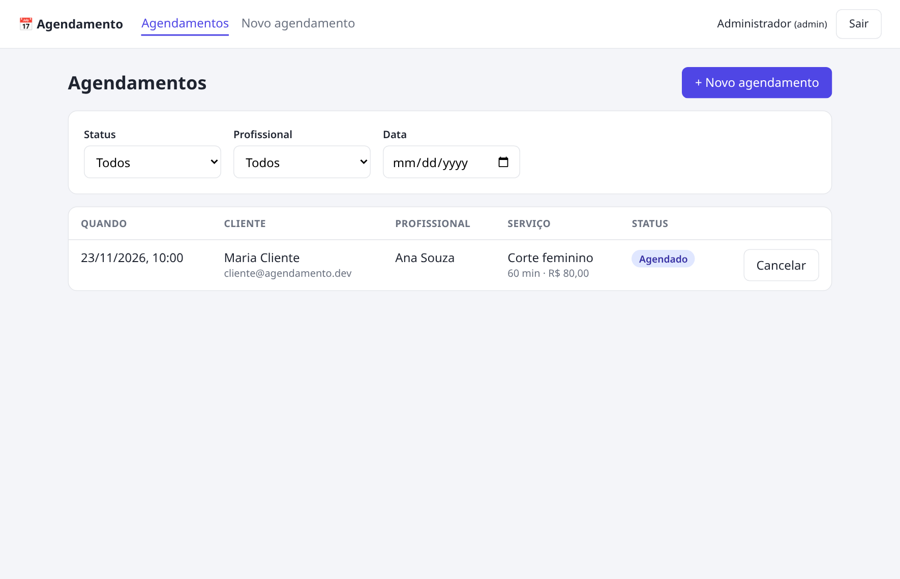
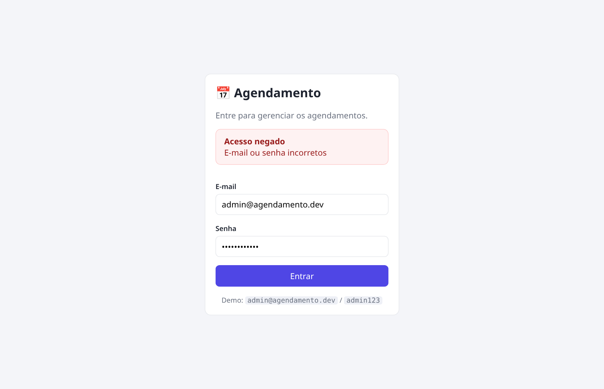
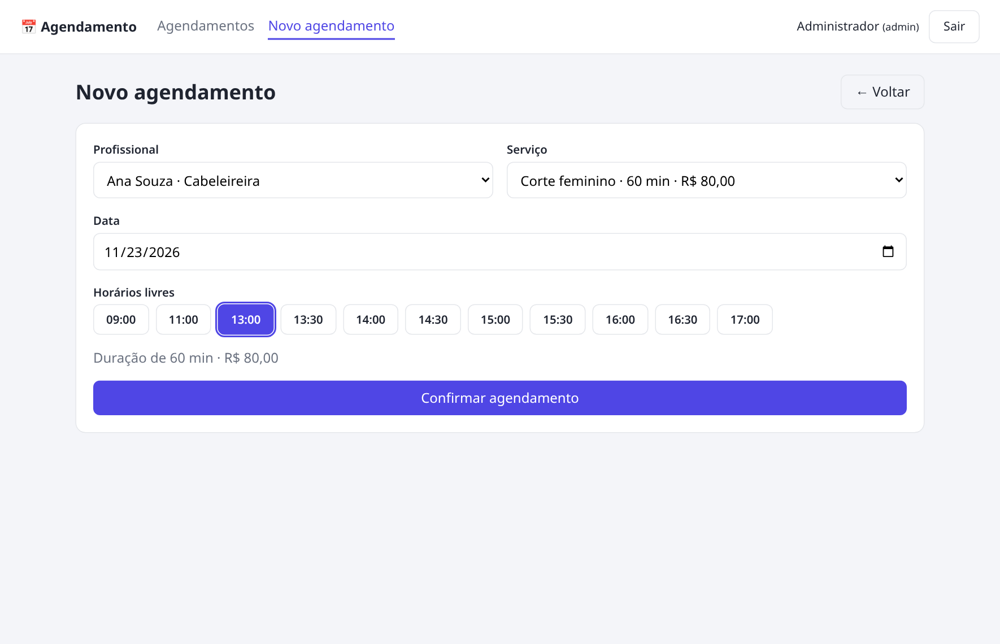
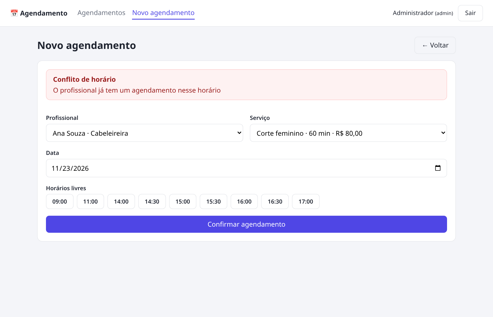

# agendamento-web

[](https://github.com/Kidolegends/agendamento-web/actions/workflows/ci.yml)

A React admin panel for my own REST API, [`agendamento-api`](https://github.com/Kidolegends/agendamento-api) (appointment booking for salons and clinics).

> **Personal portfolio project.** I made it to practice front-end architecture against an API of my own. It was written with the help of an AI coding assistant, and I study and explain every part of it. It is not production software and it has not been used by any company or customer.

🇧🇷 [Leia em português](#-português)



## What it does

- **Login with JWT.** The token is kept in `localStorage`, sent as `Authorization: Bearer ...`, and dropped automatically when the API answers `401` on a protected call.
- **Bookings list with filters.** Status and professional are filtered by the API (`GET /appointments?status=...&professionalId=...`). Date is filtered in the browser. Filters live in the URL, so a filtered view can be shared or refreshed.
- **Create a booking from free slots.** Pick professional, service and date. The panel calls `GET /professionals/:id/availability` and shows only the free slots. Nothing about working hours, lunch or conflicts is re-implemented in the front end: the API stays the single source of truth.
- **Cancel a booking** (with a confirm step). The cancellation frees the slot, so the free-slot cache is refreshed too.
- **Nice API errors.** Every error becomes an `ApiError` (status, message, field issues) and is shown by one `<ErrorAlert>` component, for example _"Conflito de horário: O profissional já tem um agendamento nesse horário"_.

| Login error                              | New booking                                    | Double-booking error                                |
| ---------------------------------------- | ---------------------------------------------- | --------------------------------------------------- |
|  |  |  |

These screenshots were taken from the real app running against the real API (seed data).

## Stack

Vite · React 19 · TypeScript (strict) · React Router · TanStack Query · React Hook Form + Zod · plain CSS · Vitest + React Testing Library · ESLint + Prettier · Docker (nginx) · GitHub Actions.

## Run it

You need Node 20+.

### 1. With the API from source

```bash
# terminal 1: the API
git clone https://github.com/Kidolegends/agendamento-api.git
cd agendamento-api
cp .env.example .env
npm install
npm run setup        # creates the SQLite DB and seeds demo data
npm run dev          # http://localhost:3333

# terminal 2: this panel
git clone https://github.com/Kidolegends/agendamento-web.git
cd agendamento-web
npm install
npm run dev          # http://localhost:5173
```

Log in with `admin@agendamento.dev` / `admin123` (or `cliente@agendamento.dev` / `cliente123`).

### 2. With Docker (API + panel together)

```bash
docker compose up --build
# panel:   http://localhost:8080
# API docs: http://localhost:3333/docs
```

By default the compose file builds the API image straight from GitHub. To use a local clone instead: `API_CONTEXT=../agendamento-api docker compose up --build`.

### Scripts

| Command                | What it does                     |
| ---------------------- | -------------------------------- |
| `npm run dev`          | Dev server with the `/api` proxy |
| `npm run lint`         | ESLint (zero warnings allowed)   |
| `npm run typecheck`    | `tsc -b`                         |
| `npm test`             | Vitest + React Testing Library   |
| `npm run build`        | Type check + production build    |
| `npm run format:check` | Prettier                         |

Configuration is in [`.env.example`](.env.example).

## Architecture

```
src/
  lib/
    api.ts        fetch wrapper: bearer token, query strings, ApiError, 401 handling
    auth.tsx      AuthProvider + useAuth (user in context, token in localStorage)
    schemas.ts    Zod schemas shared by the forms
    format.ts     currency and time-zone helpers (Intl)
    types.ts      types that mirror the API's JSON
  hooks/queries.ts  TanStack Query hooks and cache invalidation rules
  components/     Layout, ProtectedRoute, SlotPicker, ErrorAlert, StatusBadge
  pages/          LoginPage, AppointmentsPage, NewAppointmentPage
  test/           fetch mock + render helpers
```

Decisions worth explaining:

- **Server state vs. form state.** Data that lives on the server (bookings, professionals, slots) is managed by TanStack Query. Form state (what the user is typing) is managed by React Hook Form. They only meet when a form is submitted.
- **Free slots are never computed in the browser.** The API already knows working hours, lunch breaks, past times and conflicts. The panel asks `/availability` and renders the answer. A chosen slot is cleared if a refetch shows it is gone.
- **Cache invalidation.** After creating or cancelling a booking (even after a `409`), both `appointments` and `availability` queries are invalidated, so the list and the slot grid never show stale data.
- **No CORS needed.** The API has no CORS configuration, so the panel talks to `/api/*` on its own origin. In dev, Vite proxies it. In Docker, nginx proxies it to the API container.
- **Prices are integers.** The API returns `priceCents`. The panel only converts to BRL when displaying.
- **Time zones.** Slots and bookings are UTC instants. They are displayed in `VITE_TIMEZONE` (default `America/Sao_Paulo`), matching the API's `BUSINESS_UTC_OFFSET`.
- **Auth guard.** `ProtectedRoute` redirects anonymous users to `/login` and returns them to the page they wanted after login.

### Known limitations

- The API has no "list users" endpoint, so even as an admin the panel books for the logged-in user. (The API accepts `clientId` for admins; adding a client picker needs a new endpoint.)
- No registration screen, and no screens for managing professionals, services or working hours yet.
- The JWT is stored in `localStorage`, which is simple but exposed to XSS. An `HttpOnly` cookie would be safer.
- The Docker files and the compose file are written to the standard recipes, but I could only verify the app itself (tests, lint, build, and a real run against the API) on my machine. CI also builds the image.

## Tests

26 tests (Vitest + React Testing Library) cover the API client (token, query string, error mapping, 401 handling), the Zod schemas, the route guard, the login flow, the list filters, the cancel flow, and the booking flow including the `409` conflict message. The API is mocked at the `fetch` level, so the tests exercise the real client code.

---

# 🇧🇷 Português

Painel administrativo em React para a minha própria API REST, a [`agendamento-api`](https://github.com/Kidolegends/agendamento-api) (agendamentos para salões e clínicas).

> **Projeto pessoal de portfólio.** Fiz para praticar arquitetura de front-end com uma API minha. Foi escrito com ajuda de um assistente de IA, e eu estudo e sei explicar cada parte. Não é um software de produção e nenhuma empresa ou cliente usa.

## O que faz

- **Login com JWT.** O token fica no `localStorage`, vai no header `Authorization: Bearer ...` e é descartado sozinho quando a API devolve `401` numa chamada protegida.
- **Lista de agendamentos com filtros.** Status e profissional são filtrados pela API. A data é filtrada no navegador. Os filtros ficam na URL.
- **Criar agendamento pelos horários livres.** Escolha profissional, serviço e data. O painel chama `GET /professionals/:id/availability` e mostra só os horários livres. As regras (expediente, almoço, conflito, passado) ficam na API, que é a fonte da verdade.
- **Cancelar agendamento**, com etapa de confirmação. O cancelamento libera o horário, então os horários livres são recarregados.
- **Erros da API bem mostrados.** Todo erro vira um `ApiError` (status, mensagem, campos) e aparece em um único componente `<ErrorAlert>`.

## Como rodar

Precisa de Node 20+.

**Com a API pelo código-fonte**

```bash
# terminal 1: API
git clone https://github.com/Kidolegends/agendamento-api.git
cd agendamento-api && cp .env.example .env && npm install
npm run setup && npm run dev      # http://localhost:3333

# terminal 2: painel
git clone https://github.com/Kidolegends/agendamento-web.git
cd agendamento-web && npm install
npm run dev                       # http://localhost:5173
```

Login: `admin@agendamento.dev` / `admin123`.

**Com Docker (API + painel juntos)**

```bash
docker compose up --build
# painel: http://localhost:8080
```

## Arquitetura (resumo)

- `lib/api.ts`: cliente `fetch` com token, query string, `ApiError` e tratamento de `401`.
- `lib/auth.tsx`: contexto de autenticação (`AuthProvider` e `useAuth`).
- `hooks/queries.ts`: hooks do TanStack Query e regras de invalidação de cache.
- `pages/`: telas de login, lista e novo agendamento.
- **Estado do servidor** (agendamentos, horários) fica no TanStack Query. **Estado de formulário** fica no React Hook Form com Zod.
- **Sem CORS:** o painel chama `/api/*` na própria origem. No dev o Vite faz o proxy. No Docker o nginx faz o proxy para a API.
- Preços são inteiros em centavos e só viram reais na hora de exibir.

## Limitações conhecidas

- A API não tem endpoint para listar usuários, então o admin agenda para si mesmo.
- Não há tela de cadastro nem telas para gerenciar profissionais, serviços e expediente.
- O JWT fica no `localStorage`. Um cookie `HttpOnly` seria mais seguro.

## Testes

26 testes com Vitest e React Testing Library: cliente da API, schemas Zod, rota protegida, login, filtros, cancelamento e criação de agendamento (incluindo a mensagem de conflito `409`).

## Licença

MIT
